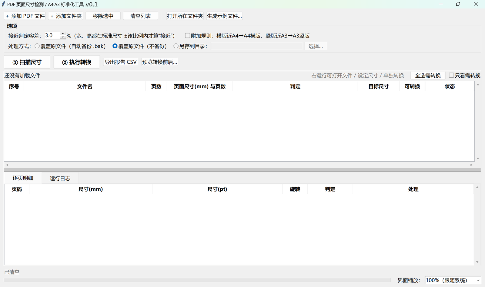

# PDF页面尺寸提取及转换

批量读出 PDF 每一页的真实尺寸，并把「竖版、尺寸接近 A4」的页面改成标准 A4、「横版、尺寸接近 A3」的页面改成标准 A3，其余页面一个字节都不动。带 Windows 图形界面，双击即用。



> 场景：合并 / 打印 / 归档 / 送审前，一堆扫描件页面大小五花八门——有的 208×295mm，有的 415×292mm，混在一起没法统一排版。这工具先把尺寸列清楚，再把该统一的统一掉，不该动的绝不动。

> **关于开发方式**：本项目由作者提出需求、定义判定规则并负责验收，代码、测试与文档在与 **AI 编程助手（Hermes Agent）** 的协作中完成；每个版本都经过自动化测试 + 作者真机试用后才发布。详见文末「[开发说明](#开发说明)」。

---

## 功能特性

- **逐页检测**：读的是页面实际显示尺寸（已考虑 `/Rotate` 旋转），换算 mm / pt，给出判定 `A4竖版` `A3横版` `A4横版` `A3竖版` `其他`
- **只改该改的**：默认只处理「竖版近 A4 → A4」「横版近 A3 → A3」；Letter、A5、自定义尺寸只报告不处理
- **等比缩放 + 居中**：按 `min(宽比, 高比)` 缩放，多出的边距平均留白，**不拉伸不变形**；文字仍是矢量
- **未命中的页 = 原样复制**：批注、表单域、书签、链接全部保留
- **文件列表交互**
  - 右键菜单：打开文件 / 打开所在文件夹 / 预览 / 设定尺寸 / 仅转换此文件 / 复制路径 / 从列表移除
  - 双击行直接打开「转换前后对比预览」
  - 「只看需转换」筛选、`全选需转换`
  - 统计条：`文件 N 个 ｜ 需转换 M 个（P 页） ｜ 无需转换 K 个 ｜ 已跳过 J 个`
  - `Ctrl` / `Shift` 多选，批量设定尺寸、批量仅转换选中
- **逐文件覆盖规则**：右键给某个（或某批）文件指定目标纸张（A4/A3/A5/B5/Letter）+ 方向（竖版/横版），或直接「跳过」；指定后该文件每一页都按此尺寸处理
- **转换前后对比预览**：左右两栏同 DPI 渲染，标尺寸、旋转、判定、缩放百分比、留白毫米数；可翻页、只看需转换页。**纯内存渲染，不写文件**
- **可拖动分割条**：文件表与「逐页明细 / 运行日志」之间高度自由调节，位置会记住
- **高 DPI 适配**：4K / 系统缩放 125%~200% 下界面与字号正常，另有 100%~250% 手动缩放（会记住）
- **安全**：临时文件写入 → 重新打开校验（页数、命中页尺寸、未命中页未变）→ 才替换；默认留 `.bak` 备份
- **CSV 报告**：UTF-8 BOM，Excel 直接打开不乱码，带「目标尺寸」列
- **命令行**：同一个 exe 兼作 CLI，可批处理 / 定时任务

---

## 运行环境

| 项目 | 要求 |
|---|---|
| **操作系统** | **Windows 10 / 11（x64）** —— 主要目标平台，也是唯一做过完整验证的平台 |
| 图形界面 | 需要桌面环境（tkinter）；无图形界面的服务器上只能走命令行 |
| **运行 Python** | **3.8 及以上**（源码运行 / 自行打包 exe 时需要；直接用 exe 则不需要） |
| **第三方依赖** | 仅 **PyMuPDF**（`pip install pymupdf`）；tkinter 随 Python 自带，无需另装 |
| 打包工具 | PyInstaller（仅运行 `打包exe.bat` 时需要，脚本会自动安装） |
| 其他平台 | Linux / macOS 可以跑源码（`python pdfsize_gui.py`），但**未测试、未适配**（高 DPI 适配、`.bat` 脚本、`.bak` 备份逻辑均按 Windows 设计） |

- **用 exe**：`打包exe.bat` 产出单文件 `PDF页面尺寸工具.exe`，拷到任意 Windows 双击即用，目标机器无需装 Python。
- **用源码**：目标机器需要 Python 3.8+，双击 `启动.bat` 会自动装 PyMuPDF 后启动。

---

## 快速开始

### 方式 A：下载发布包

到 Releases 页下载 `pdfsize-tool-v0.1.zip`，解压后：

- 有 Python 3.8+ → 直接双击 `启动.bat`
- 想免装 Python → 先双击 `打包exe.bat` 生成 `dist\PDF页面尺寸工具.exe`，之后拷这个 exe 到任意 Windows 双击即用

> 发布包内**不含预编译 exe**（作者构建环境为 Linux，无法交叉打包 Windows 可执行文件），需要 exe 请按上面第二种方式自行打包一次。

### 方式 B：源码运行（需 Python 3.8+）

双击 `启动.bat`，首次会自动 `pip install pymupdf`，然后打开界面。

### 方式 C：自己打包 exe

双击 `打包exe.bat`，产物在 `dist\PDF页面尺寸工具.exe`（单文件，可拷到任意 Windows）。
也可以在 GitHub 上自动打包：推一个 `v*` 标签（或在 Actions 里手动 Run workflow），
`build-exe` 工作流会在 `windows-latest` 上跑 `build_exe.py`，把 `pdfsize-tool-exe.zip` 挂到对应 Release。

### 方式 D：命令行

```bat
:: 只看尺寸，导出 CSV
PDF页面尺寸工具.exe scan "D:\合同" --csv "D:\尺寸报告.csv"

:: 转换：输出到新目录（原文件不动）
PDF页面尺寸工具.exe convert "D:\合同" --outdir "D:\合同_A4"

:: 转换：就地覆盖（自动备份 .bak）
PDF页面尺寸工具.exe convert "D:\合同" -y

:: 容差 5%，并启用附加规则（横版近A4→A4横版、竖版近A3→A3竖版）
PDF页面尺寸工具.exe convert "D:\合同" --tol 5 --extra --outdir "D:\输出"

:: 不管原来多大，统一成 A4 竖版（加 --landscape 则 A4 横版）
PDF页面尺寸工具.exe convert "D:\扫描" --to A4 --outdir "D:\输出"

:: 自检（返回码 0 = 正常）
PDF页面尺寸工具.exe --check
```

用源码跑就把 `PDF页面尺寸工具.exe` 换成 `python pdfsize_gui.py`。

---

## 判定规则

| 判定 | 含义 | 默认是否处理 |
|---|---|---|
| `A4竖版` | 竖版，宽高都接近 210×297mm | ✅ → 标准 A4 210×297mm |
| `A3横版` | 横版，宽高都接近 420×297mm | ✅ → 标准 A3 420×297mm |
| `A4横版` | 横版、接近 297×210mm | ❌ 只报告（勾「附加规则」才处理） |
| `A3竖版` | 竖版、接近 297×420mm | ❌ 只报告（勾「附加规则」才处理） |
| `其他` | Letter 216×279、A5、扫描件不规则尺寸 | ❌ 只报告（可右键指定尺寸） |

「接近」= **宽、高各自都在标准尺寸 ±3% 以内**（界面可调 0.1%~20%）。宽高分开判、先判方向，
所以 Letter（宽 +2.8%、高 −6.1%）不会被误判成 A4。容差调到 6% 就会把 Letter 一起吞掉——慎调。

---

## 界面怎么用

> 想先验证？点工具栏 **生成示例文件…**，选个空文件夹，会造 5 个测试 PDF（近A4竖版 / 近A3横版 / Letter / 混合5页 / 近A3竖版）并问你是否立刻扫描。

1. **＋ 添加 PDF 文件** / **＋ 添加文件夹**（含子文件夹）
2. **① 扫描尺寸** → 表格列出页数、尺寸分布、判定、目标尺寸、可转换页数；选中某行看「逐页明细」
3. 看统计条确认「需转换」个数与页数
4. 需要特殊处理的行右键设定目标尺寸
5. 想看清楚就 **预览转换前后**（双击行 / 右键 / 工具栏）
6. **② 执行转换** → 确认框写清几个文件几页、其中几个用了指定尺寸；转换后自动重扫
7. **导出报告 CSV**

### 文件列表操作

| 想做什么 | 怎么做 |
|---|---|
| 打开 PDF 看内容 | 右键 → 打开文件 |
| 打开所在文件夹 | 右键 → 打开所在文件夹 |
| 只看要转换的 | 勾表格右上角 **只看需转换** |
| 一次选中所有要转的 | **全选需转换** |
| 多选 | `Ctrl` 点选 / `Shift` 连选 / `Ctrl+A` |
| 只转某一个 | 右键 → **仅转换此文件** |
| 批量设定尺寸 | 多选 → 右键 → **批量设定转换尺寸…** |
| 调整上下分区 | 拖动表格与明细之间的**分割条**（位置会记住） |
| 从列表移除 | 右键 → 从列表移除（**不删硬盘文件**） |

### 逐文件设定转换尺寸

右键 → **设定转换尺寸…**，两个下拉：

- **目标尺寸**：`自动（按规则）` / `A4` / `A3` / `A5` / `B5` / `Letter` / `跳过（不处理）`
- **方向**：`竖版` / `横版`（选「自动」「跳过」时禁用）

语义：

- **自动** = 按上表判定（默认）
- **纸张 + 方向** = 把这个文件的**每一页**都等比缩放居中到该尺寸，不管原来是 A3 还是 Letter；已在该尺寸的页不动
- **跳过** = 整个文件不参与转换，计入「已跳过」

撤销：右键 → **恢复为自动规则**。规则在一次运行内有效（重扫不丢），关程序后重置。

### 预览对比

左「原始」右「转换后」，**同 DPI 渲染**，大小差异是真实比例。图上标尺寸/旋转/判定/缩放百分比，
底部写留白毫米数。本页不转换时右侧直接写原因。支持翻页、输页码、勾「只看需转换页」、`←` `→`。

### 选项

- **接近判定容差**：默认 3%。扫描件偏得厉害调到 5%，怕误改调到 1~2%
- **处理方式**：`覆盖原文件（自动备份 .bak）`（默认）/ `覆盖原文件（不备份）` / `另存到目录`（推荐先用这个）
- **附加规则**：默认关；勾上额外处理「横版近A4→A4横版」「竖版近A3→A3竖版」

---

## 高分辨率屏幕（4K / 系统缩放 125%~200%）

1. 创建窗口**之前**声明 Per-Monitor V2 DPI 感知（`SetProcessDpiAwarenessContext` → 回退 `SetProcessDpiAwareness(2)` → `SetProcessDPIAware`）
2. 按真实 DPI 设 `tk scaling`，窗口尺寸、行高、列宽、边距全部同比例放大（4K@200% 窗口 2360×1560，行高 52px）
3. 底部右下角 **界面缩放**：100%（跟随系统）/110%/125%/150%/175%/200%/250%，立即重排并记住（存 `%APPDATA%\pdfsize-tool.json`）

启动时「运行日志」第一行会打印 `系统 DPI 约 144（系统缩放 150%），界面再放大 100%`。

---

## 安全设计

- 转换先写**同目录临时文件**，重开校验：页数一致、命中页到达目标尺寸（±0.5mm）、未命中页尺寸未变
- 校验通过才 `os.replace`；不通过就报错，原文件**一点没动**
- 覆盖模式默认先复制 `xxx.pdf.bak`（重名自动编号，不覆盖旧备份）
- 加密 PDF、损坏文件只报错不处理，不影响其他文件
- 预览纯内存渲染不写文件；「从列表移除」不删硬盘文件
- 已经是目标尺寸（±0.5mm）的页面直接跳过，不重复重写

已知代价：命中页面是重新嵌入的，**该页上的批注 / 表单域不会带过去**（超链接会尽量搬）；文件级元数据、书签目录尽量保留。

---

## 文件清单

```
pdfsize_core.py    核心逻辑（检测 / 规则 / 转换 / 预览渲染 / CSV / 命令行），无界面依赖
pdfsize_gui.py     tkinter 图形界面（也是命令行入口）
build_exe.py       PyInstaller 打包脚本（参数集中在此）
启动.bat           双击即用（源码模式）
打包exe.bat        双击生成单文件 exe
requirements.txt   运行依赖：pymupdf
_selftest.py       开发用：造样本 PDF 验证检测/转换
_ui_test.py        开发用：真实窗口端到端自测（55 项断言）
_layout_audit.py   开发用：量化检查控件越界 / 被压缩
_shot.py           开发用：Xvfb 截图看真实布局
_dpi_probe.py      开发用：打印各缩放档位的 DPI / 窗口 / 行高
_publish.py        开发用：通过 GitHub API 发布（本机连不上 github.com 时用）
docs/              界面截图
.github/workflows/ build-exe.yml —— 在 GitHub 的 Windows 机器上自动打包 exe 并挂到 Release
```

自测：

```bat
python pdfsize_core.py --check
python pdfsize_gui.py  --check
python _selftest.py
python _ui_test.py        :: 需桌面环境，弹窗自动应答
```

依赖只有 **PyMuPDF**（`pip install pymupdf`），tkinter 为 Python 自带。

---

## 常见问题

**Q：我的 A4 文件没被处理？**
A：要么它已经是标准尺寸（差 <0.5mm），要么其实是 Letter/A5/自定义——看「判定」列。想处理就调大容差，或右键单独指定尺寸。

**Q：右键菜单没反应？**
A：先点中一行（让它变蓝）再右键；空白区域右键不弹菜单。多选后右键，菜单变成批量操作。

**Q：设了目标尺寸，内容会被裁掉吗？**
A：不会。等比缩放后居中，多出的边距留白，预览窗口底部写明留白毫米数。留白太多说明比例差得远（A3 硬塞 A4 的必然结果）。

**Q：转换后文件变大 / 变小？**
A：变大多是命中页重新嵌入导致图片重编码；变小多是冗余对象被清理。内容不变。

**Q：能处理扫描件（图片型 PDF）吗？**
A：能。尺寸调整与内容是文字还是图片无关。

**Q：几百个文件会卡死界面吗？**
A：扫描 / 转换在后台线程，界面不冻结，底部有进度条。实测 600 页 / 30 文件：扫描 0.05s，转换 0.44s。

**Q：输出目录能放在待处理文件夹里面吗？**
A：可以，会自动跳过输出目录里的文件。

**Q：重复转换到同一输出目录？**
A：同名覆盖（输出目录保持干净）。若输出目录就是原目录，按「覆盖原文件」处理并生成 `.bak`。

**Q：换了显示器 / 改了系统缩放，界面大小不对？**
A：启动时日志第一行会打印检测到的 DPI；用底部右下角【界面缩放】手动调，选一次就会记住。

---

## 开发说明

**协作方式**：需求与验收标准由作者定义——页面尺寸判定规则（方向优先 + 宽高各自 ±3%）、等比缩放不拉伸、未命中页面零改动、高 DPI 适配、转换前校验再替换等，全部是作者提出的硬要求；代码实现、自动化测试与文档由 **AI 编程助手（Hermes Agent）** 在作者的要求与多轮反馈下完成。作者逐版真机试用、提出缺陷与改进项，并决定是否发布。

**为什么写这段**：一是如实标注代码来源；二是给使用者一个判断依据——代码经过自动化测试与人工试用，但**没有经过第三方安全审计**，用于合同、档案等关键业务前，请先在小范围样本上试跑，确认效果后再批量处理。

**测试覆盖**（都在仓库里，可自己跑）：

| 脚本 | 内容 |
|---|---|
| `_selftest.py` | 造 7 类样本 PDF（近A4/近A3/Letter/A5/旋转页/混合页/坏文件），断言检测与转换结果 |
| `_ui_test.py` | 真实 Tk 窗口端到端，55 项断言（扫描/筛选/规则/批量/预览/转换/CSV/分割条/缩放重建） |
| `_layout_audit.py` | 遍历控件树，量化检查越界、被压缩、被压扁 |
| `_dpi_probe.py` | 打印各缩放档位的 DPI / 窗口尺寸 / 行高 / 列宽 |

已在 **96dpi（1920×1200）与 192dpi（4K@200%）** 两种显示环境下各跑一遍，并做过 600 页 / 30 文件的性能测试（扫描 0.05s、转换 0.44s）。

**反馈**：遇到问题请开 [Issue](../../issues)，附上 PDF 的页面尺寸（或「导出报告 CSV」的对应行）和你的系统缩放比例，比截图更有用。

---

## 版本历史

**v0.1**（首个公开版本）

- 逐页尺寸检测 + 判定分类（A4竖版 / A3横版 / A4横版 / A3竖版 / 其他）
- 竖版近A4 → A4、横版近A3 → A3 自动标准化，等比缩放居中
- 文件列表：右键菜单、双击预览、只看需转换、数量统计、可拖动分割条
- 逐文件 / 批量指定目标纸张与方向、跳过
- 转换前后同 DPI 对比预览（纯内存）
- 高 DPI 适配 + 100%~250% 界面缩放并记忆
- CSV 报告、命令行 `scan` / `convert`、PyInstaller 打包脚本

---

## 许可证

本仓库代码：MIT（见 [LICENSE](LICENSE)）。
运行时依赖 PyMuPDF 为 **AGPL-3.0**，个人 / 内部自用无碍，商业分发请自行确认其许可条款。
